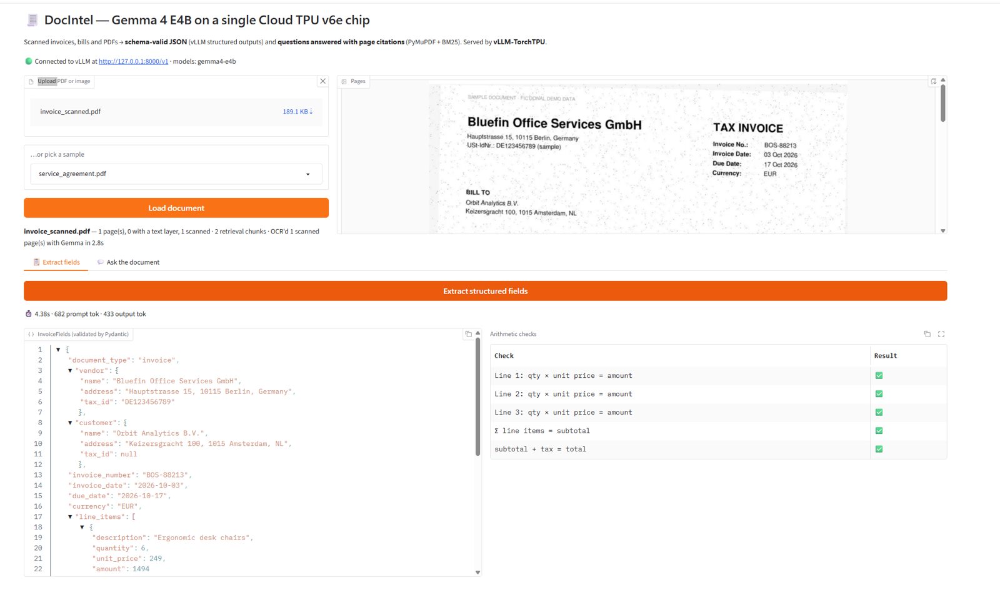

# gemma4-docintel-tpu

**Gemma 4 E4B-it on a single Cloud TPU v6e chip with vLLM-TorchTPU**: from `pip install` to a
live OpenAI-compatible `vllm serve`, a document-intelligence app on top of it, and a serving
benchmark of prefill-heavy vs decode-heavy workloads with prefix caching on and off.

- 🧾 **Extraction:** scanned invoices, bills, receipts and PDFs → JSON that is guaranteed to match
  a Pydantic schema (vLLM structured outputs), plus arithmetic consistency checks.
- 💬 **Cited Q&A:** questions answered from the document with **page citations**
  (PyMuPDF page text or Gemma OCR → BM25 retrieval → schema-constrained answer).
- 🖥️ **Gradio UI** for both, running against the TPU-served model.
- 📊 **Benchmark:** TTFT, TPOT and throughput for a long shared document context vs long
  generations, with prefix caching on and off.

> Built for the TPU Sprint on a `ct6e-standard-4t` Flex-start VM (europe-west4-a), using one of
> its four v6e chips. vLLM-TorchTPU 0.33.0, libtpu 0.0.50, Python 3.12.



*A scanned, image-only invoice → Gemma OCR on TPU (2.8 s) → schema-valid JSON with every
arithmetic check passing (4.4 s).*

---

## Results at a glance

All numbers are p50 values on **1× TPU v6e**, single runs. Full tables:
[`results/REPORT.md`](results/REPORT.md). Raw data: [`results/results.jsonl`](results/results.jsonl).

### 1. Prefix caching makes document Q&A 5–7× faster to first token

Workload: a 7,081-token shared document plus a short question (answers average about 20 tokens).

| Concurrent requests | TTFT, cache off → on | Requests/s, off → on | TPOT, off → on |
|---|---|---|---|
| 1 | 170 → **35 ms** (4.8×) | 2.9 → 4.7 | 9.1 → 9.2 ms |
| 4 | 183 → **49 ms** (3.7×) | 4.8 → 6.5 | 28.0 → 11.0 ms |
| 16 | 601 → **83 ms** (7.3×) | 5.1 → **16.2** (3.2×) | 103 → **18 ms** |

99% of prompt tokens are served from the cache. The gain *grows* with load, because without
caching every request recomputes about 7k tokens of prefill.

### 2. Prefill slows down generation for everyone

Without caching, at 16 concurrent requests, **time per output token jumps from 9 ms to 103–113 ms**.
New long prompts share every scheduler step with requests that are already generating, so
generation stalls. Caching removes most of that prefill work, so generation stays fast (18 ms).

### 3. The control run confirms it's the cache

The `unique` workload has the same prompt length, but each request starts with a unique preamble,
so nothing can be reused. It shows **≈1.0× with caching on or off**. Raw prefill speed is about
**42k prompt tokens/s** (7.1k tokens to first token in 170 ms), leveling off around 36–41k
tokens/s under load.

### 4. Long generations scale with batching

Workload: a 30-token prompt and 512 output tokens.

| Concurrent requests | TPOT | Output tokens/s |
|---|---|---|
| 1 | 8.9 ms | **112** |
| 4 | 9.0 ms | 402–438 |
| 16 | 11.4 ms | **1,142–1,157** |

That's **10× the throughput for 28% more per-token latency**. Decoding is limited by memory
bandwidth, so the chip has spare compute to share across requests. Prefix caching doesn't change
this, as expected.

### 5. App latencies (from the UI, warm)

| Step | Time |
|---|---|
| OCR of a scanned invoice page (Gemma vision) | 2.8–3.3 s (23 s on the first, compiling call) |
| Invoice → schema-valid JSON (682 prompt + 433 output tokens) | 4.4 s with compact JSON (5.1 s before) |
| Cited answer over retrieved passages | 0.27 s |

### Serving facts from the logs

- **Memory:** weights take 14.7 GiB of the 31.2 GiB HBM. vLLM-TorchTPU automatically uses an
  **FP8 (e5m2) KV cache** on v6e, which fits **152,224 tokens** (≈9 concurrent full-length
  16k-token requests).
- **Startup:** the first start compiles TPU graphs for 10 token-padding buckets (16 → 8192):
  **266 s**. Later starts load them from the compile cache: **17 s** (100 s total).
- **Kernels:** Pallas attention for all 42 layers (35 sliding-window layers with 256-dim heads,
  7 full-attention layers with 512-dim heads). The 14.9 GiB checkpoint loads in about 6 s.

---

## Architecture

```
 PDF / image ──► PyMuPDF ──► page images (JPEG) + text layer
                               │          └─(no text layer)─► Gemma OCR on TPU
                               ▼
     ┌──── Extract: page images + text ──► vLLM (json_schema) ──► InvoiceFields ✔ Pydantic
     │                                                             └► arithmetic checks
     └──── Ask: question ──► BM25 top-k [page N] chunks ──► vLLM (json_schema) ──► Answer + citations
                                                  │
                           vLLM-TorchTPU · Gemma 4 E4B-it · 1× v6e chip · prefix cache · FP8 KV
```

```
gemma4-docintel-tpu/
├── setup.sh                # tcmalloc + Python 3.12 venv + vllm-torchtpu + app deps
├── serve.sh                # vllm serve on one chip; PREFIX_CACHING=on|off
├── requirements.txt
├── app/
│   ├── schema.py           # Pydantic InvoiceFields / Answer + consistency checks
│   ├── documents.py        # PyMuPDF rendering, text layer, scanned-page detection
│   ├── retrieval.py        # page-tagged chunking + BM25
│   ├── llm.py              # OCR, extraction, cited QA (retry + plain-text fallback)
│   └── ui.py               # Gradio app
├── bench/
│   ├── bench.py            # async streaming load generator (TTFT/TPOT/throughput/cache hits)
│   ├── run_matrix.sh       # caching on/off × {prefill, unique, decode} × concurrency {1,4,16}
│   └── report.py           # results.jsonl → REPORT.md
├── results/                # REPORT.md + results.jsonl from the run above
├── scripts/make_samples.py # fictional demo documents
├── samples/                # invoice (digital + scanned), receipt photo, 8-page agreement
└── tests/fake_vllm.py      # stand-in OpenAI server for developing without a TPU
```

---

## Quick start

### 0. Get a TPU v6e VM

Create a `ct6e-standard-4t` VM with the Flex-start provisioning model and a **200 GB** boot disk.
Capacity is shared, so queuing requests in several zones at once (us-east5-b, us-central1-a,
europe-west4-a, southamerica-west1-a) gets you a VM much sooner:

```bash
gcloud compute instances create tpu-v6e-vm \
  --zone=europe-west4-a --machine-type=ct6e-standard-4t \
  --provisioning-model=FLEX_START --request-valid-for-duration=2h \
  --max-run-duration=24h --instance-termination-action=DELETE \
  --image-project=ubuntu-os-accelerator-images \
  --image-family=ubuntu-accel-2204-amd64-tpu-v5e-v5p-v6e \
  --maintenance-policy=TERMINATE --boot-disk-size=200GB
```

You also need a Hugging Face account with access to `google/gemma-4-E4B-it` (accept its license
on the model card if prompted).

### 1. Install

```bash
git clone https://github.com/<you>/gemma4-docintel-tpu.git && cd gemma4-docintel-tpu
./setup.sh                      # tcmalloc, uv, Python 3.12 venv, vllm-torchtpu, app deps
source ~/vllm-venv/bin/activate
hf auth login
```

`setup.sh` sets `UV_TORCH_BACKEND=cpu` before running `uv pip install vllm-torchtpu`, so no CUDA
wheels are pulled. The plugin brings matching `vllm`, `torch`, `torch_tpu` and `libtpu`. It ends by
printing `vLLM platform: tpu`.

### 2. Serve

```bash
tmux new -s vllm
./serve.sh                      # wait for "Application startup complete."  (Ctrl+B, D to detach)
```

What `serve.sh` runs:

```bash
LD_PRELOAD=libtcmalloc_minimal.so.4 \
TPU_VISIBLE_CHIPS=0 TPU_CHIPS_PER_PROCESS_BOUNDS=1,1,1 TPU_PROCESS_BOUNDS=1,1,1 \
vllm serve google/gemma-4-E4B-it --served-model-name gemma4-e4b \
  --tensor-parallel-size 1 --max-model-len 16384 --max-num-seqs 64 \
  --max-num-batched-tokens 8192 --limit-mm-per-prompt '{"image": 4, "audio": 0}' \
  --structured-outputs-config '{"backend": "xgrammar", "disable_any_whitespace": true}' \
  --enable-prefix-caching --host 127.0.0.1 --port 8000
```

Smoke test for structured output:

```bash
curl -s localhost:8000/v1/chat/completions -H 'Content-Type: application/json' -d '{
  "model":"gemma4-e4b","max_tokens":64,
  "messages":[{"role":"user","content":"Invoice: 2 chairs at 249.00. What is the total?"}],
  "response_format":{"type":"json_schema","json_schema":{"name":"t","schema":
    {"type":"object","properties":{"total":{"type":"number"}},"required":["total"]}}}}'
# → "content": "{\"total\":498.00}"
```

### 3. Run the app

```bash
tmux new -s app
python -m app.ui                # http://127.0.0.1:7860 on the VM
```

To open it from your laptop, tunnel port 7860:

```bash
gcloud compute ssh tpu-v6e-vm --zone=europe-west4-a -- -L 7860:localhost:7860 -N
```

Then browse to <http://127.0.0.1:7860>. On Windows, gcloud runs this through PuTTY.
Alternatively, add the tunnel under PuTTY → Connection → SSH → Tunnels (source `7860`,
destination `localhost:7860`).

**Demo:**
1. Load `invoice_scanned.pdf` → **Extract structured fields**. The page has no text layer, so
   Gemma OCRs it, then returns schema-valid JSON with all arithmetic checks ✅.
2. Load `service_agreement.pdf` → **Ask**: *"When can the provider suspend services?"* The answer
   cites **p.4**, with the BM25 passages shown underneath.
3. Ask the invoice something it doesn't contain: the answer correctly says *not found*.

### 4. Benchmark

```bash
tmux new -s bench
./bench/run_matrix.sh           # ≈20 min; restarts vLLM with caching on, then off
cat results/REPORT.md
```

| Workload | Shape | What it isolates |
|---|---|---|
| `prefill` | ~7.1k-token **shared** document + short question, ≤64 output tokens | Prefill cost and the prefix cache's effect |
| `unique` | Same length, unique preamble per request | Control: same work, no cache reuse |
| `decode` | ~30-token prompt, 512 output tokens (`ignore_eos`) | Decode speed and batching |

**TTFT** is the time from sending the request to the first streamed token. **TPOT** =
(E2E − TTFT) / (output tokens − 1). The **cache hit rate** comes from vLLM's `/metrics` counters.
Each run sends 2 unmeasured warm-up requests first.

---

## Lessons learned

- **Constrained JSON can run away on whitespace.** With the default grammar, Gemma once emitted
  hundreds of tab characters between JSON fields and hit `max_tokens` with the JSON unfinished. The
  output was valid *so far* but never completed. Setting `disable_any_whitespace: true` (xgrammar
  backend) forces compact JSON and fixed it. As a safety net, `app/llm.py` also retries once and then
  falls back to a plain-text answer with `[p.N]` citations.
- **Keep the compile cache.** The first start compiles for about 4.5 minutes; restarts take about
  1.5 minutes.
- **Flex-start VMs can't be stopped, only deleted,** and are deleted automatically at
  `--max-run-duration`. Copy `results/` off the VM before then.
- **Thinking mode is off** (`chat_template_kwargs.enable_thinking=false`) for low-latency
  extraction. Set `ENABLE_THINKING=1` to try it.
- **No TPU handy?** Run `uvicorn tests.fake_vllm:app --port 8000`. It simulates the server
  (prefill cost, prefix cache, streaming, structured outputs), so you can develop the UI and
  benchmark anywhere. Its numbers are synthetic.

## Caveats

- vLLM-TorchTPU lists v6e as **experimental** (v7x is its CI target), and Gemma 4 E4B isn't on its
  validated-model list. It worked end to end here, with zero failed requests across 576 measured
  benchmark requests.
- These are single benchmark runs. Quote p50 values: some p90 TTFT values include queueing and
  one-time compiles.
- With caching on, "total tok/s" counts reused prompt tokens, so read it as *effective*
  throughput. The `unique` rows show raw prefill throughput.
- All sample documents are **fictional** and stamped "SAMPLE / DEMO DATA".

## License

Code: Apache-2.0 (add a `LICENSE` file, or swap in your preferred license). The Gemma 4 model
weights are covered by the license on their [Hugging Face model card](https://huggingface.co/google/gemma-4-E4B-it).
